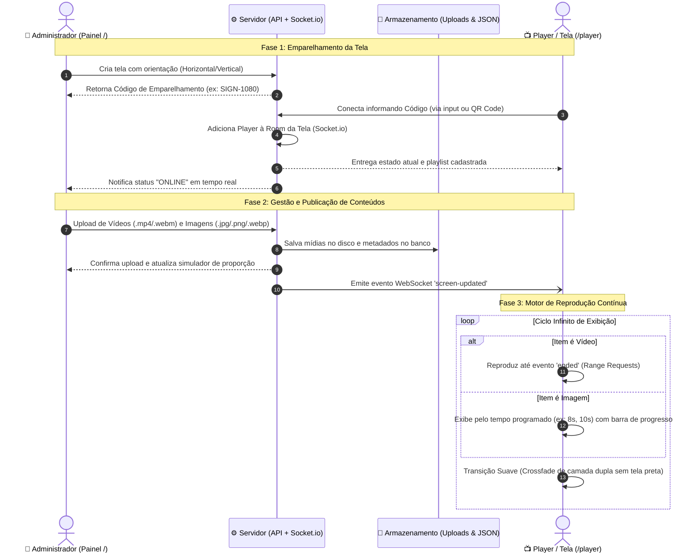
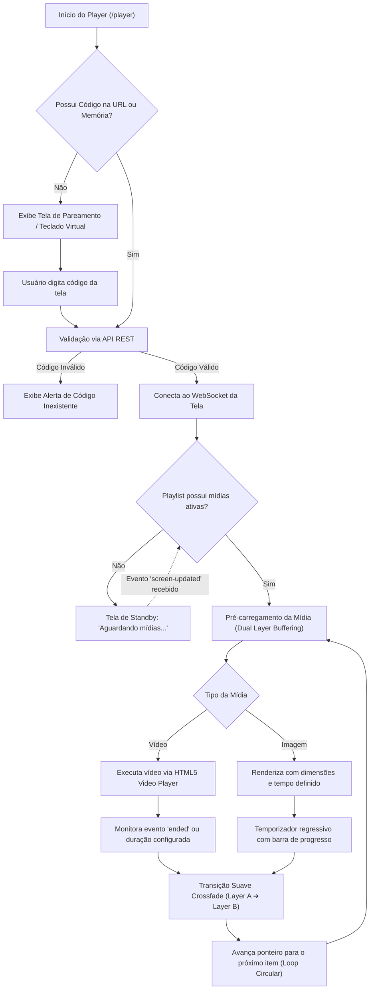

<div align="center">

# 📺 Display Manager
### Plataforma Web de Sinalização Digital & Gestão de Mídias (Digital Signage)

*Uma solução robusta, moderna e em tempo real para controle e exibição de conteúdos multimídia em Smart TVs, Totens Verticais, Monitores Comerciais e Dispositivos Móveis.*

<br/>

[](https://nodejs.org/)
[](https://expressjs.com/)
[](https://www.docker.com/)
[](https://socket.io/)
[](https://tailwindcss.com/)

</div>

---

## 📌 Visão Geral

O **Display Manager** é um ecossistema web de sinalização digital desenvolvido para sincronizar painéis de controle e telas de reprodução de maneira instantânea e desacoplada. 

O sistema opera através de duas rotas principais integradas via WebSockets:
1. **Rota Administrativa (`/`)**: Centraliza a gestão de telas, upload de arquivos multimídia (vídeos e imagens), organização de playlists e parametrização de orientação geométrica (**Horizontal 16:9** ou **Vertical 9:16**).
2. **Rota do Player (`/player`)**: Interface de exibição contínua em tela cheia (*Full Screen*), acoplada à tela por meio de um código de emparelhamento único ou leitura de QR Code, equipada com transição fluida (*crossfade*) e motor de reprodução inteligente.

---

## 🔄 Fluxo de Funcionamento & Arquitetura

O diagrama abaixo detalha a jornada da informação, desde o upload até a reprodução nos terminais de exibição:



---

## 🧠 Arquitetura do Motor de Reprodução

Para garantir uma experiência de exibição ininterrupta (*24/7*), o player adota os seguintes padrões de engenharia de software:



---

## 🌟 Principais Recursos

### 1. Painel de Controle Multitelas (`/`)
* **Códigos Únicos de Conexão:** Cada display possui um identificador alfanumérico amigável (ex: `SIGN-1080`), permitindo conexão sem senhas complexas.
* **Orientação Flexível:**
  * 🖥️ **Horizontal (1920 × 1080 - 16:9):** Otimizado para Smart TVs, monitores comerciais e videowalls.
  * 📱 **Vertical (1080 × 1920 - 9:16):** Configurado para totens verticais, painéis de shopping e quiosques.
  * Opções de enquadramento: **Conter (*Contain*)** ou **Preencher (*Cover*)**.
* **Upload Otimizado:** Suporte a arrastar e soltar (*Drag & Drop*) com barra de progresso em tempo real.
  * **Vídeos:** `.mp4`, `.webm`, `.mov`, `.ogg`
  * **Imagens:** `.jpg`, `.jpeg`, `.png`, `.webp`, `.gif`, `.svg`
* **Gerenciador de Playlist:**
  * Ajuste de tempo de exibição individual para imagens.
  * Pausa rápida de mídias sem necessidade de exclusão.
  * Simulador de proporção ao vivo com pré-visualização instantânea.
* **Status em Tempo Real:** Sinalizador visual indicando se a tela física está `ONLINE` ou desconectada.

### 2. Player de Alta Performance (`/player`)
* **Modo Full Screen Imersivo:** Suporte a tela cheia nativa acionada por botão, clique duplo ou atalho no teclado (**tecla `F`**).
* **Crossfade Sem Telas Pretas:** Arquitetura de camada dupla (*Layer A* e *Layer B*) que pré-carrega o conteúdo seguinte antes de esmaecer o anterior.
* **Autoplay Resiliente:** Tratamento inteligente de políticas de restrição de áudio do navegador (inicia com reprodução silenciosa garantida e exibe alerta não-bloqueante para ativação sonora).
* **Interface Invisível:** O cursor do mouse e a barra de controle flutuante somem após 3 segundos de inatividade, preservando a estética de sinalização comercial.
* **Acesso Simplificado via QR Code:** Conecte celulares, tablets e Smart TVs apontando a câmera diretamente para o QR Code gerado no painel.

---

## 🚀 Como Executar

### Opção 1: Execução com Docker (Recomendada para Produção) 🐳

1. Certifique-se de que o **Docker Desktop** ou o daemon do Docker esteja ativo.
2. Na raiz do projeto, execute:
   ```bash
   docker compose up -d --build
   ```
   *(No Windows, você também pode dar duplo clique no arquivo `docker-start.bat`)*

3. Para inspecionar os logs operacionais:
   ```bash
   docker compose logs -f
   ```

4. Para encerrar os serviços:
   ```bash
   docker compose down
   ```
   *(ou execute `docker-stop.bat`)*

> 💾 **Persistência de Dados Garantida:** As pastas `./uploads` (mídias enviadas) e `./data` (banco de dados das telas e playlists) são vinculadas como volumes locais, mantendo todos os arquivos intactos entre atualizações de contêineres.

---

### Opção 2: Execução Direta via Node.js

1. Instale as dependências:
   ```bash
   npm install
   ```

2. Inicie o servidor:
   ```bash
   npm start
   ```

3. Acesse em seu navegador:
   * **Painel Administrativo:** [http://localhost:3000/](http://localhost:3000/)
   * **Player Fullscreen:** [http://localhost:3000/player](http://localhost:3000/player)

---

### Opção 3: Publicação no GitHub Pages (100% Estático & Gratuito) 🌐

A aplicação conta com arquitetura **Dual Mode**: funciona tanto em servidores Node.js/Docker quanto de forma 100% estática e *serverless* no **GitHub Pages**, utilizando **IndexedDB** para persistência no navegador e **BroadcastChannel** para sincronização em tempo real entre abas.

#### Como ativar o GitHub Pages no seu repositório:

1. No seu repositório no GitHub, clique na aba **Settings** (Configurações).
2. No menu lateral esquerdo, clique em **Pages** (em *Code and automation*).
3. Na seção **Build and deployment**:
   * **Source:** Selecione **GitHub Actions** (o arquivo `.github/workflows/deploy-pages.yml` já está configurado para publicar automaticamente a cada push).
   * *Ou, se preferir o modo clássico:* Selecione **Deploy from a branch**, escolha a branch **`main`** e a pasta **`/docs`**, e clique em **Save**.
4. Aguarde cerca de 1 a 2 minutos e sua aplicação estará online no endereço:
   ```
   https://flaviohfranca.github.io/Gerenciador-de-Telas-M-dias/
   ```

---

## 📱 Acesso em Dispositivos Móveis e Smart TVs

Para abrir o Player em celulares, tablets ou Smart TVs conectadas na mesma rede local:

1. No Painel Administrativo, abra o card da tela desejada e clique em **"Abrir no Celular (QR Code)"**.
2. Aponte a câmera do dispositivo para o **QR Code** exibido.
3. Caso prefira digitar manualmente, use o IP da sua máquina na rede local:
   ```
   http://<IP_DO_COMPUTADOR>:3000/player?code=SEU_CODIGO
   ```

> 💡 **Dica de Firewall (Windows):** Se o dispositivo móvel não carregar a página na rede Wi-Fi, o Firewall do Windows pode estar restringindo a porta 3000. Basta clicar com o botão direito no arquivo **`liberar-firewall-porta-3000.bat`** e selecionar **"Executar como Administrador"**.

---

## 📂 Estrutura do Projeto

```
.
├── Dockerfile                   # Definição da imagem de contêiner (Node 20 Alpine)
├── docker-compose.yml           # Orquestração com volumes persistentes e portas
├── docker-start.bat             # Inicializador rápido para ambiente Windows
├── docker-stop.bat              # Script para encerramento de contêineres
├── liberar-firewall-porta-3000.bat # Script de automação de regra do firewall
├── server.js                    # Servidor Express, API REST e Socket.io
├── data/
│   └── screens.json             # Persistência estruturada das telas e playlists
├── uploads/                     # Diretório de armazenamento de fotos e vídeos
└── public/
    ├── index.html               # Interface da Rota 1 (Painel de Gestão)
    ├── player.html              # Interface da Rota 2 (Player Full Screen)
    ├── css/
    │   ├── admin.css            # Estilização do dashboard e mockups
    │   └── player.css           # Estilização do player e camadas de transição
    └── js/
        ├── admin.js             # Lógica do painel, uploads e WebSockets
        └── player.js            # Engine de reprodução contínua e fullscreen
```

---

## ⌨️ Atalhos do Player

| Tecla / Ação | Função |
| :--- | :--- |
| **`F`** ou **Duplo Clique** | Alterna modo Tela Cheia (*Full Screen*) |
| **`Barra de Espaço`** / **`→`** | Avança manualmente para a próxima mídia |
| **`←`** | Retorna para a mídia anterior |
| **Mover o Mouse / Toque** | Exibe a barra de controles flutuante temporariamente |

---

## 📄 Licença

Distribuído sob a licença **MIT**. Consulte o arquivo de licença para mais informações.
